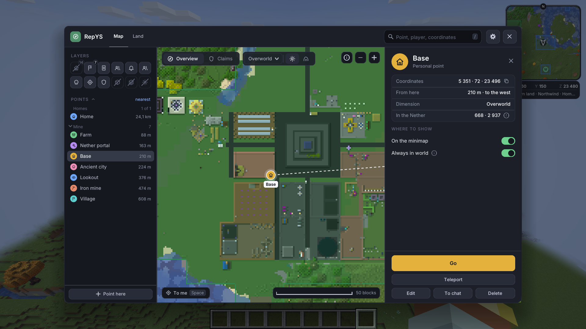

# RYSMap

*Русская версия ниже: [по-русски](#по-русски).*



**World map and minimap.** Points, layers, caves floor by floor, players and mobs on the map. On a server the mod adds homes, warps and teleporting from the map, with rules set by the operator. Your explored world isn't lost: when a modpack migrates, the explored map and points carry over from FTB Chunks, and homes and warps from FTB Essentials.

## Features

- a minimap and a map window
- points with labels in the world
- caves floor by floor and all dimensions
- layers: players, mobs, heights, light, slime chunks
- search by point, player and coordinates
- homes, warps, "back" and player requests
- teleporting from the map under server rules
- saving the map as a PNG

## Requirements

- Minecraft 1.21.1, NeoForge 21.1.x. The server side is needed for homes, warps, teleporting, operator rules and the slime layer; the map, minimap and points work without it.
- No other mods required.
- Optional: Waystones; waystones appear on the map.
- Languages: English and Russian.

## Download and help

- Download: [CurseForge](https://www.curseforge.com/minecraft/mc-mods/rysmap).
- Help, ideas and questions: [Discord](https://discord.gg/Tqgy7acmyd).
- Bugs: [GitHub Issues](https://github.com/MityaKr/RYSMap/issues).

## Documentation

- [docs/format.md](docs/format.md): how the map is stored on disk.

The documents are in Russian.

## The RYS family

RYSMap is part of the RYS family of mods: one style, shared themes and settings. Each mod works on its own, and together they complement each other.

- [RYSQuests](https://www.curseforge.com/minecraft/mc-mods/rysquests), a quest book with guides and a shop.
- [RYSIndex](https://www.curseforge.com/minecraft/mc-mods/rysindex), a recipe viewer with crafting trees.
- [RYSClaims](https://www.curseforge.com/minecraft/mc-mods/rysclaims), chunk land claims.
- [RYSTeams](https://www.curseforge.com/minecraft/mc-mods/rysteams), player teams with roles and alliances.
- [RYSHelm](https://www.curseforge.com/minecraft/mc-mods/ryshelm), the Server window for admins.

## Building from source

You need Java 21. The build takes the family's shared code from the [RYSCore](https://github.com/MityaKr/RYSCore) repository, which must sit next to this one and be published to its local `repo/` folder first:

```
git clone https://github.com/MityaKr/RYSCore
git clone https://github.com/MityaKr/RYSMap
cd RYSCore && ./gradlew publish
cd ../RYSMap && ./gradlew build
```

The jar is in `build/libs`.

## License

The code is under [MPL-2.0](LICENSE). The graphics and the RYS name remain with the author, see [NOTICE.md](NOTICE.md). You can include the mod in any modpack without asking for permission.

Author: MityaYS, RepkaWorks.

---

## По-русски

**Карта мира и миникарта.** Точки, слои, пещеры по этажам, игроки и мобы на карте. На сервере мод добавляет дома, варпы и телепорт с карты, а правила задаёт оператор. Исследованный мир не пропадёт: при переезде сборки открытая карта и точки переносятся из FTB Chunks, дома и варпы из FTB Essentials.

### Возможности

- миникарта и окно карты
- точки с подписями в мире
- пещеры по этажам и все измерения
- слои: игроки, мобы, высоты, свет, чанки слизней
- поиск по точкам, игрокам и координатам
- дома, варпы, «назад» и запросы к игроку
- телепорт с карты по правилам сервера
- сохранение карты в PNG

### Требования

- Minecraft 1.21.1, NeoForge 21.1.x. Серверная часть нужна для домов, варпов, телепорта, правил оператора и слоя слизней; карта, миникарта и точки работают и без неё.
- Других модов не требует.
- По желанию: Waystones, камни пути появляются на карте.
- Языки: русский и английский.

### Скачать и спросить

- Скачать: [CurseForge](https://www.curseforge.com/minecraft/mc-mods/rysmap).
- Помощь, идеи и вопросы: [Discord](https://discord.gg/Tqgy7acmyd).
- Баги: [GitHub Issues](https://github.com/MityaKr/RYSMap/issues).

### Документация

- [docs/format.md](docs/format.md): как карта хранится на диске.

### Семья RYS

RYSMap входит в семью модов RYS: один стиль, общие темы и настройки. Каждый мод работает сам по себе, а вместе они дополняют друг друга.

- [RYSQuests](https://www.curseforge.com/minecraft/mc-mods/rysquests), книга квестов с гайдами и магазином.
- [RYSIndex](https://www.curseforge.com/minecraft/mc-mods/rysindex), справочник рецептов с деревом крафта.
- [RYSClaims](https://www.curseforge.com/minecraft/mc-mods/rysclaims), приват земли по чанкам.
- [RYSTeams](https://www.curseforge.com/minecraft/mc-mods/rysteams), команды игроков с ролями и союзами.
- [RYSHelm](https://www.curseforge.com/minecraft/mc-mods/ryshelm), окно «Сервер» для администраторов.

### Сборка из исходников

Нужна Java 21. Общий код семьи сборка берёт из репозитория [RYSCore](https://github.com/MityaKr/RYSCore): он должен лежать рядом с этим и сначала выложиться в свою папку `repo/` командой `gradlew publish` (команды выше). Готовый jar лежит в `build/libs`.

### Лицензия

Код под [MPL-2.0](LICENSE), графика и имя RYS остаются за автором, подробности в [NOTICE.md](NOTICE.md). Мод можно включать в любую сборку без отдельного разрешения.

Автор: MityaYS, RepkaWorks.
